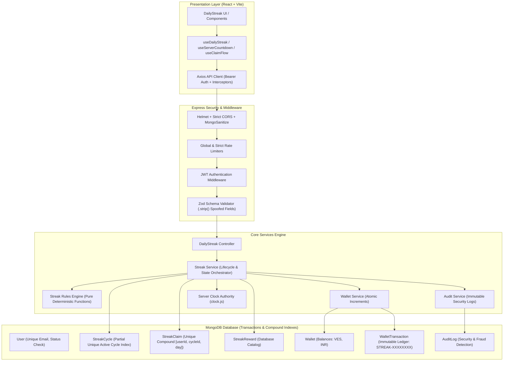

# VELoop Rewards — Daily Streak & Rewards System

A production-grade, secure, backend-driven 7-day streak engine and premium responsive React application for **VELoop Rewards**.

> **The Fundamental Rule:** React controls the presentation. The backend controls the streak.

---

## 📑 Table of Contents
1. [Architecture Overview](#-architecture-overview)
2. [Design Decisions](#-design-decisions)
3. [Stack & Technology Choices](#-stack--technology-choices)
4. [Streak & Claim Engine Lifecycle](#-streak--claim-engine-lifecycle)
5. [Database Schema & Audit Traceability](#-database-schema--audit-traceability)
6. [Security & Anti-Cheat Protections](#-security--anti-cheat-protections)
7. [Installation & Setup](#-installation--setup)
8. [Automated & Manual Testing](#-automated--manual-testing)
9. [Deployment Guide](#-deployment-guide)
10. [Definition of Done Self-Audit](#-definition-of-done-self-audit)

---

## 🏗️ Architecture Overview

The system is architected as an asynchronous, decoupled full-stack application built with Node.js, Express, MongoDB (Mongoose), and React (Vite). All streak calculations, eligibility determinations, clock references, and reward transactions execute strictly on the server.



---

## 📐 Design Decisions

1. **Two-Phase Claim Flow:**
   - Claims are split into `initiateClaim` (`POST /api/daily-streak/claim`) and `confirmClaim` (`POST /api/daily-streak/claim/confirm`).
   - Phase 1 verifies server-derived eligibility and requested day accuracy, creating/reusing a `PENDING` claim with `demoReadyAt = now + cpaDemoSeconds * 1000`. No currency or voucher is granted here.
   - Phase 2 validates that `now >= demoReadyAt` and executes an atomic MongoDB transaction committing the claim, updating cycle progression, crediting balances, and creating an immutable ledger transaction.

2. **Per-Day Status Mapping:**
   - `CLAIMED`: Reward already claimed in the current active cycle. Displayed with a green border, checkmark, and disabled state.
   - `AVAILABLE`: Claim window is active (`nextClaimAt <= now <= expiresAt`). Displayed with gold outline and interactive "Claim Now ›" CTA.
   - `TODAY`: Next upcoming reward during cooldown (`now < nextClaimAt`). Displayed with violet outline and live monotonic `HH:MM:SS` countdown timer.
   - `LOCKED`: Future rewards beyond the immediate next day.
   - `MISSED`: Unclaimed days from a previous cycle that expired.

3. **Interval & Window Configuration (`StreakConfig`):**
   - All timing constants derive from MongoDB `StreakConfig` (`claimIntervalHours: 24`, `claimWindowHours: 24`, `cpaDemoSeconds: 3`, `pendingClaimTtlSeconds: 120`). Zero hardcoded `86400000` constants exist in business logic.

4. **Gift Card Fulfilment Status:**
   - Digital gift cards (e.g. Day 4 ₹1, Day 5 ₹2, Day 7 ₹5 Amazon Gift Cards) are saved to `WalletTransaction` with `status: PENDING_FULFILLMENT`, allowing VELoop operations to fulfill vouchers asynchronously while VES coin rewards are immediately `COMPLETED`.

5. **Continuous Streaks Across Completed Cycles:**
   - Upon claiming Day 7, the active cycle marks `COMPLETED`, and a new cycle begins at Day 1 unlocking at `lastClaimAt + claimIntervalHours`. Cumulative `streakCount` continues seamlessly across cycles (e.g. Day 8, 9, 10...).

6. **Developer Time-Travel & Reset:**
   - Dedicated endpoints (`POST /api/dev/time-travel` and `POST /api/dev/reset-user`) exist strictly for evaluator testing when `ENABLE_DEV_TOOLS=true` and `NODE_ENV !== 'production'`. Every use records an immutable `DEV_TIME_TRAVEL` audit entry.

7. **Asset Fallback Mapping:**
   - Mapped in `frontend/src/assets/index.jsx` with crisp SVG vector fallbacks for all required types (`coin`, `gift-box`, `gift-card`, `crown`, `calendar`, `gem`, `logo`), ensuring zero missing images or layout shift.

---

## 🛠️ Stack & Technology Choices

- **Backend:** Node.js (v26+ ES Modules), Express.js, MongoDB + Mongoose 8.
- **Frontend:** React 18, Vite 6, Bootstrap 5 (grid/reset only), CSS Modules, Framer Motion, Lucide React, Axios, Canvas Confetti.
- **Security:** Helmet, strict CORS allowlist, bcryptjs, JSON Web Tokens (JWT), Zod input sanitization, Express Rate Limit, Express Mongo Sanitize.
- **Testing:** Jest (VM modules mode), Supertest, MongoDB Memory Server (Replica Set mode).

---

## 🔄 Streak & Claim Engine Lifecycle

```
[User Opens /daily-streak]
         │
         ▼
[GET /api/daily-streak]
         │
   (Lazy Reset Check: now > expiresAt ?)
     ├── YES ──> [Mark Cycle BROKEN] ──> [Audit STREAK_RESET] ──> [Spin Up Cycle at Day 1 with resetNotice]
     └── NO  ──> [Compute Streak Phase (WAITING / READY) & Resolve Day Statuses]
         │
         ▼
[UI Renders 7 Cards] ──> User clicks "Claim Now" on Day N
         │
         ▼
[POST /api/daily-streak/claim] (Phase 1)
   ├── Validate User Active & Eligible
   ├── Check requestedDay == serverCurrentDay
   ├── Check not already claimed
   └── Create PENDING StreakClaim (demoReadyAt = now + 3s)
         │
         ▼
[UI Shows CpaDemo Modal] ──> Progress ring fills for 3 seconds
         │
         ▼
[POST /api/daily-streak/claim/confirm] (Phase 2)
   ├── Validate claim exists & belongs to JWT userId
   ├── Verify now >= demoReadyAt (otherwise CLAIM_NOT_READY)
   ├── Verify now <= pendingExpiresAt (otherwise CLAIM_EXPIRED)
   └── [MongoDB Atomic Transaction]
         ├── Conditional findOneAndUpdate on StreakCycle
         ├── Update StreakClaim status PENDING -> COMPLETED
         ├── Atomic $inc on Wallet balances
         ├── Insert WalletTransaction (STREAK-XXXXXXXX)
         └── Audit Log STREAK_CLAIM_SUCCESS
         │
         ▼
[UI Shows Gold Shimmer + Confetti] ──> [Refreshes State from Backend]
```

---

## 📊 Database Schema & Audit Traceability

Traceability Chain:
`StreakClaim` → `StreakReward` → `WalletTransaction` → `Wallet.balances`

Key Collections:
- **`User`**: Identifiers, bcrypt password hashes, and active/suspended status checks.
- **`Wallet`**: Balances `{ VES: Number, INR: Number }` (non-negative integers).
- **`StreakConfig`**: Single active document defining cycle lengths and cooldown windows.
- **`StreakReward`**: Rewards catalog for Days 1 to 7 with badges and reward amounts.
- **`StreakCycle`**: Partial unique compound index guarantees at most one active cycle per user:
  `{ userId: 1 }, { unique: true, partialFilterExpression: { status: 'ACTIVE' } }`
- **`StreakClaim`**: Composite index `{ userId: 1, cycleId: 1, day: 1 }` guarantees idempotent claims.
- **`WalletTransaction`**: Immutable double-entry ledger with `referenceId: STREAK-XXXXXXXX`.
- **`AuditLog`**: Complete audit trail for claim requests, completions, rejections, resets, and dev tools.

---

## 🔒 Security & Anti-Cheat Protections

1. **Zero Client Trust:** Client-sent `streak`, `reward`, `amount`, `currency`, `userId` are stripped by Zod.
2. **Server Clock Authority:** Countdown and claim readiness derive exclusively from the server clock (`clock.js`).
3. **Concurrency-Safe:** Simultaneous requests via `Promise.all` result in exactly one wallet credit; race conditions resolve to idempotent replays or `ALREADY_CLAIMED`.
4. **Cross-User Protection:** Claim confirmations verify both `claimId` AND authenticated `userId`; cross-account attacks return 404.
5. **NoSQL Injection & Rate Limiting:** All requests sanitized via `express-mongo-sanitize` with global and sensitive endpoint rate limiters.

---

## 🚀 Installation & Setup

### Prerequisites
- Node.js >= 18.0.0
- MongoDB instance (MongoDB Atlas dev cluster or local MongoDB)

### 1. Clone & Install
```bash
# Clone the repository
git clone <repo-url>
cd veloop-daily-streak

# Install root, backend, and frontend dependencies
npm install
```

### 2. Backend Environment Setup
```bash
cd backend
cp .env.example .env
```
Configure `.env`:
```env
PORT=5000
NODE_ENV=development
MONGO_URI=mongodb+srv://<user>:<password>@cluster0.mongodb.net/veloop_rewards?retryWrites=true&w=majority
JWT_SECRET=super_secret_jwt_key_at_least_32_characters_long
CLIENT_ORIGIN=http://localhost:5173
ENABLE_DEV_TOOLS=true
```

### 3. Seed Database
```bash
npm run seed
```
Seeds:
- Default `StreakConfig`
- 7 `StreakRewards`
- Demo user: `demo@veloop.test / Demo@1234` with initial wallet of **120 VEs**.

### 4. Start Development Servers
```bash
# In backend/
npm run dev

# In frontend/
cd ../frontend
cp .env.example .env
npm run dev
```

Visit `http://localhost:5173` to access the application.

---

## 🧪 Automated & Manual Testing

### Running Automated Test Suite
```bash
cd backend
npm test
```
Executes all 27 tests covering:
- Normal claim progression (Day 1 -> Day 2)
- Cooldown timer locking (`STILL_LOCKED`)
- Tampered device clock resistance
- Duplicate claim prevention
- Concurrent confirm requests via `Promise.all` (exactly one credit)
- Fake reward amounts, currencies, streaks, and user IDs
- Cross-user claim authorization rejection
- Missed day lazy reset and reset notice
- Full 7-day cycle completion

### Postman Verification
Import `postman/veloop_rewards.postman_collection.json` and `postman/veloop_rewards.postman_environment.json`. See [docs/TESTING.md](docs/TESTING.md) for step-by-step instructions.

---

## 🌐 Deployment Guide

### 1. Database (MongoDB Atlas)
1. Create a free M0 cluster on [MongoDB Atlas](https://www.mongodb.com/atlas).
2. Create a Database User with read/write privileges.
3. In Network Access, allow access from anywhere (`0.0.0.0/0`) or specific provider IP ranges.
4. Copy the connection string into the backend `MONGO_URI` environment variable.

### 2. Backend Deployment (Render / Railway)
1. Connect your repository to Render or Railway.
2. Set root directory to `backend`.
3. Build command: `npm install`.
4. Start command: `node src/server.js`.
5. Add environment variables:
   - `PORT=5000`
   - `NODE_ENV=production`
   - `MONGO_URI=<your-atlas-connection-string>`
   - `JWT_SECRET=<32-char-random-secret>`
   - `CLIENT_ORIGIN=https://<your-frontend-domain>.vercel.app`
   - `ENABLE_DEV_TOOLS=false`

### 3. Frontend Deployment (Vercel / Netlify)
1. Import repository to Vercel or Netlify.
2. Root directory: `frontend`.
3. Framework preset: `Vite`.
4. Build command: `npm run build`.
5. Output directory: `dist`.
6. Environment variable:
   - `VITE_API_URL=https://<your-backend-domain>.onrender.com/api`

---

## ✅ Definition of Done Self-Audit

| Requirement Question | Status | Proof |
|---|---|---|
| Can I change my streak/day/claim status with DevTools or React DevTools and gain anything? | **NO** | Backend evaluates all states exclusively against MongoDB data; client-sent values are discarded. |
| Can I send a fake reward/amount/currency/streak/userId? | **NO** | Stripped by Zod schemas (`.strip()`); user identity is derived exclusively from verified JWT signature. |
| Can I change my device clock and claim early? | **NO** | Server clock (`clock.js`) is the sole authority; premature claims reject with `STILL_LOCKED`. |
| Can I request Day 7 while eligible for Day 2? | **NO** | Server enforces `currentDay` match; mismatches reject with `DAY_MISMATCH` and write an `INVALID_CLAIM` audit. |
| Can I claim the same day twice, or via simultaneous requests, or from two tabs? | **NO** | Concurrency test with `Promise.all` confirms exactly one credit; duplicate confirms return idempotent replays. |
| Does a genuinely missed streak reset to Day 1 and show the reset message? | **YES** | Lazy reset detects `now > expiresAt`, marks cycle `BROKEN`, creates new Day 1 cycle, and displays `ResetBanner`. |
| Does a refresh / logout-login show identical state from MongoDB? | **YES** | State is re-hydrated on mount via `GET /api/daily-streak`. |
| Can I trace StreakClaim → Reward → WalletTransaction → Wallet balance in MongoDB? | **YES** | Verified via schema indexes and transaction audit trail (`STREAK-XXXXXXXX`). |
| Does the timer come from backend `serverTime`/`nextClaimAt` and re-verify with the backend at zero? | **YES** | `useServerCountdown` uses monotonic performance anchor and queries `GET /daily-streak/status` at zero. |
| Do loader, skeleton, error, locked, claimed, countdown, reset and CPA-demo states all exist? | **YES** | Verified in components `StreakLoader`, `StreakSkeleton`, `ErrorState`, `CpaDemo`, `ResetBanner`, `RewardCard`. |
| Does it look extremely close to the supplied mobile and desktop designs with zero horizontal overflow? | **YES** | Responsive layouts for 320px–1920px+ with touch targets >= 44px and zero overflow. |
| Are all submission checklist items present? | **YES** | Clean Git repo, documentation (`docs/`), Postman collection, `.env.example`, demo credentials, and demo script. |
