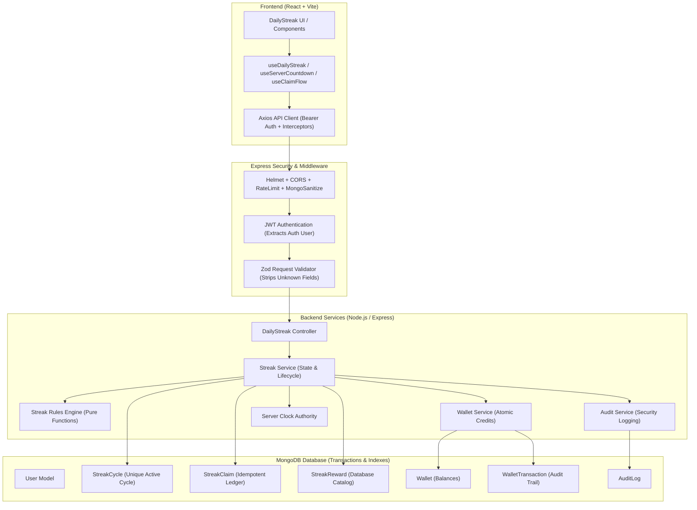

# VELoop Rewards — Daily Streak & Rewards System

A production-grade, secure, backend-driven 7-day streak engine and premium responsive React application for **VELoop Rewards**.

> **The Fundamental Rule:** React controls the presentation. The backend controls the streak.

---

## 🏗️ Architecture Overview

The VELoop Rewards system is structured as a decoupled full-stack MERN application ensuring strict server authority, zero client-trust, and high performance.



---

## 📐 Design Decisions

As mandated by Section 0, key design choices are documented here:

1. **Two-Phase Claim Flow:**
   - Claims are split into `initiateClaim` (`POST /api/daily-streak/claim`) and `confirmClaim` (`POST /api/daily-streak/claim/confirm`).
   - The first phase validates eligibility, initiates a `PENDING` claim record, and sets `demoReadyAt = now + cpaDemoSeconds`. The client displays the CPA advertisement demo during this time.
   - The confirmation phase requires `now >= demoReadyAt` and executes inside an atomic MongoDB transaction. No reward is granted if the user cancels or attempts to confirm early.

2. **Per-Day Status Mapping:**
   - `CLAIMED`: Claim completed successfully in the active cycle.
   - `AVAILABLE`: Claim window is active (`nextClaimAt <= now <= expiresAt`) and previous requirements met.
   - `TODAY`: The next upcoming day to claim while still locked waiting for cooldown (`now < nextClaimAt`). Shows real-time server countdown.
   - `LOCKED`: Future days beyond today.
   - `MISSED`: Days in a previous cycle that were not claimed before expiration.

3. **Interval & Window Configuration (`StreakConfig`):**
   - Configurable values stored in the database: `cycleLength = 7`, `claimIntervalHours = 24`, `claimWindowHours = 24`, `pendingClaimTtlSeconds = 120`, `cpaDemoSeconds = 3`.
   - Never uses hardcoded constants (`86400000`) anywhere in logic.

4. **Gift Card Fulfilment Status:**
   - When a user claims a gift card (e.g. Day 4, 5, 7 Amazon Gift Cards), the transaction is recorded with `status: PENDING_FULFILLMENT` because voucher codes are fulfilled and dispatched asynchronously by the VELoop operations team. VES rewards are immediately `COMPLETED`.

5. **Cycle Completion & Continuous Streak:**
   - Completing Day 7 sets the current cycle to `COMPLETED`. A new cycle begins for Day 1, unlocking at `lastClaimAt + claimIntervalHours`.
   - Total `streakCount` continues seamlessly across completed cycles, encouraging long-term user retention.

6. **Dev Time-Travel & Reset:**
   - Dedicated testing endpoints (`POST /api/dev/time-travel` and `POST /api/dev/reset-user`) are enabled only when `ENABLE_DEV_TOOLS=true` and `NODE_ENV !== 'production'`. Every invocation writes an audit record (`DEV_TIME_TRAVEL`).

7. **Asset Fallback Mapping:**
   - All visual assets (`coin`, `gift-box`, `gift-card`, `crown`, `calendar`, `gem`, `logo`) are mapped in `frontend/src/assets/index.js` with crisp, high-resolution SVG stand-ins matching the violet/gold theme, ensuring zero broken images.

---

## 📦 Repository Layout

```
veloop-daily-streak/
├── frontend/                  # React (Vite) Presentation Layer
│   ├── src/
│   │   ├── assets/            # Central asset map (index.js) & SVG vectors
│   │   ├── components/        # Reusable UI components
│   │   ├── context/           # AuthContext, ToastContext
│   │   ├── hooks/             # useDailyStreak, useServerCountdown, useClaimFlow
│   │   ├── pages/             # Login, Register, DailyStreak, History
│   │   ├── services/          # Axios instance and API service modules
│   │   └── styles/            # tokens.css, index.css
│   ├── .env.example
│   ├── package.json
│   └── vite.config.js
├── backend/                   # Express.js REST API & Streak Engine
│   ├── src/
│   │   ├── config/            # DB connection, env schema
│   │   ├── controllers/       # HTTP request handlers
│   │   ├── middleware/        # Auth, rate limit, error handler, request ID
│   │   ├── models/            # Mongoose schemas (User, Wallet, StreakConfig, etc.)
│   │   ├── routes/            # Express route modules
│   │   ├── services/          # Business logic (streak, rules, wallet, audit)
│   │   ├── validators/        # Zod input schemas
│   │   ├── app.js             # Express app configuration
│   │   └── server.js          # Server entrypoint
│   ├── seed/                  # Seed script for initial config, rewards, and demo user
│   ├── tests/                 # Supertest and Jest integration/unit test suite
│   ├── .env.example
│   └── package.json
├── docs/                      # Architectural documentation
│   ├── API_DOCUMENTATION.md
│   ├── DATABASE.md
│   ├── SECURITY.md
│   └── TESTING.md
├── postman/                   # Postman collection & environment
├── README.md
└── .gitignore
```

---

## 🚀 Quick Start & Installation

### Prerequisites
- Node.js >= 18 (Tested on Node.js v26)
- MongoDB instance (MongoDB Atlas dev cluster or local MongoDB instance)

### 1. Backend Setup
```bash
cd backend
cp .env.example .env
npm install
npm test
npm run dev
```

### 2. Frontend Setup
```bash
cd frontend
cp .env.example .env
npm install
npm run dev
```

---

## 🔒 Security Summary

- **Server-driven state**: Client cannot forge streak counts, claim dates, or reward amounts.
- **Zod input sanitization**: Strips any client-sent fields like `reward`, `amount`, `currency`, `userId`.
- **Concurrency & Idempotency**: Atomic conditional updates and unique composite index on `(userId, cycleId, day)` prevent double-credit and race conditions.
- **Rate Limiting**: Protects against brute-force and rapid claim spamming.
- **Audit Logging**: Comprehensive logging of claim requests, successes, rejections, and resets.
